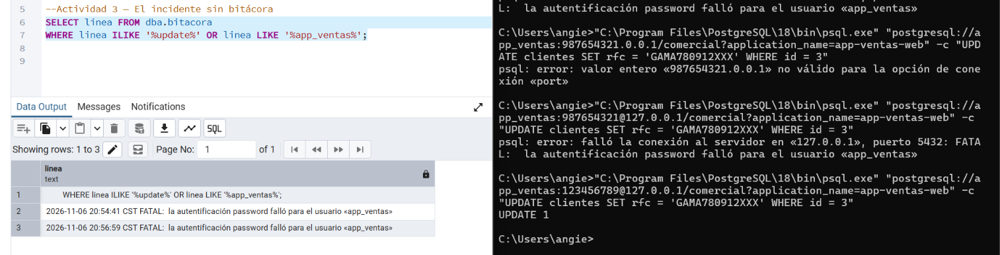

# LAB-01 — Bitácoras y auditoría del dato en PostgreSQL
_Gestión de seguridad y desempeño de bases de datos_

**Camacho Castañeda Angélica María 4-1** 

 ## Actividad 3 — El incidente sin bitácora

**¿Se puede demostrar quién modificó el RFC?**
No. El UPDATE se ejecutó (psql respondió UPDATE 1), pero la bitácora no lo registró porque log_statement está en none. Solo aparecen dos errores FATAL de autenticación fallida de app_ventas y la línea de la propia consulta. Además, el prefijo (%t) no incluye usuario ni IP.

**¿Se puede demostrar que el cambio no lo hizo soporte_ana?**
No. Como el cambio no quedó registrado, no hay forma de saber qué usuario lo hizo ni de descartar a soporte_ana o a cualquier otro. Que no aparezca en la bitácora no prueba su inocencia.

**¿Los privilegios de la Unidad II impidieron el cambio? ¿Debían impedirlo?**
No lo impidieron: app_ventas tenía permiso de UPDATE sobre clientes. En parte no debían impedirlo, porque es el rol de la aplicación de ventas, aunque el RFC es sensible y pudo restringirse con permisos por columna. Los privilegios son un control preventivo y no dejan evidencia de quién hizo qué.

**¿Qué debió estar configurado antes del incidente?**
log_statement = 'mod' (o 'all').
log_connections y log_disconnections en on.
Un log_line_prefix con usuario, base de datos, IP y aplicación, por ejemplo '%m [%p] %u@%d %h %a '.
