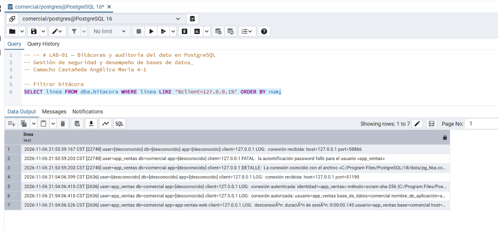

# LAB-01 — Bitácoras y auditoría del dato en PostgreSQL
_Gestión de seguridad y desempeño de bases de datos_

**Camacho Castañeda Angélica María 4-1** 
### Actividad 5 — Accesos exitosos y fallidos
## 11.1 Leer una línea campo por campo

| Campo | Valor | Significado |
| --- | --- | --- |
| Fecha y hora | 2026-10-25 22:50:00.334 UTC | Momento en que el servidor registró el evento, con milisegundos y zona horaria. Sirve para ordenar la cronología. |
| PID | 91 | Proceso del servidor que atendió la conexión. Todas las líneas de una misma conexión comparten el PID. |
| Usuario | app_ventas | Rol con el que el cliente dijo conectarse. No está verificado, porque la autenticación falló. |
| Base de datos | comercial | Base a la que se intentó conectar. |
| Aplicación | [unknown] | El nombre de la aplicación aún no estaba disponible cuando falló la autenticación. |
| Cliente | 127.0.0.1 | Dirección de origen de la conexión. En este caso es el mismo equipo (localhost). |
| Severidad | FATAL | Error que termina la conexión. |
| Mensaje | password authentication failed | La contraseña recibida no coincide con la del rol. |
| Regla aplicada | pg_hba.conf línea 119 | Regla de pg_hba.conf que coincidió con la conexión y que exigió la contraseña. |

## Preguntas

**La bitácora registra el usuario app_ventas en el intento fallido. ¿Eso prueba que la aplicación de ventas intentó entrar? ¿Qué prueba realmente?**
No lo prueba. El nombre de usuario lo escribe el cliente, así que cualquiera puede declararse app_ventas. Lo que prueba es que alguien se conectó desde esa dirección (127.0.0.1) pidiendo entrar como app_ventas y no logró autenticarse. No identifica a la persona ni al programa.

**¿Qué información adicional registra PostgreSQL cuando el rol no existe? ¿Por qué aparece en la bitácora y no en el mensaje que recibe el cliente?**

Agrega una línea de DETALLE que indica que el rol no existe. El cliente recibe el mismo mensaje genérico de contraseña incorrecta, exista el rol o no, para que un atacante no pueda averiguar qué usuarios existen. El detalle real queda solo en la bitácora, que es de uso interno del administrador.

**¿Por qué app=[unknown] en el intento fallido, pero app=app-ventas-web en la desconexión?**

El servidor aplica el application_name hasta que la autenticación se completa. En el intento fallido la conexión terminó antes, por eso no hay nombre. En la desconexión, la sesión ya había entrado y el nombre estaba aplicado. Además, ese nombre lo declara el cliente, así que tampoco sirve como prueba de identidad.

**¿Qué patrón de varias líneas haría sospechar de un ataque de fuerza bruta? Escribe la consulta que contaría los intentos fallidos por usuario.**

El patrón sospechoso es un montón de línea de autenticación fallida, con segundos o milisegundos de diferencia entre sí, que vienen de la misma IP. Pueden dirigirse a un mismo usuario (fuerza bruta) o a muchos usuarios distintos. Si después aparece una conexión autenticada del mismo cliente, es todavía más grave.
