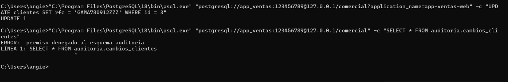
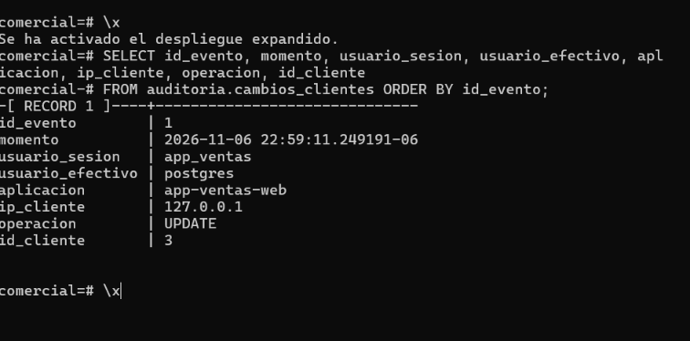

# LAB-01 — Bitácoras y auditoría del dato en PostgreSQL
_Gestión de seguridad y desempeño de bases de datos_

**Camacho Castañeda Angélica María 4-1** 

### Actividad 12 — El incidente auditado
 
**Compara tu hipótesis de la Actividad 11 con este resultado.**
Mi hipótesis era que, sin SECURITY DEFINER, el INSERT de la auditoría correría con los privilegios de app_ventas, fallaría con permission denied y cancelaría también el UPDATE. El resultado muestra el caso contrario, que es el real con SECURITY DEFINER: el UPDATE se ejecutó y el disparador guardó la fila (id_evento = 1) con usuario_sesion = app_ventas, aunque app_ventas no tiene permiso sobre la tabla de auditoría.

**Escribe la sentencia UPDATE que restauraría el valor anterior.**

_UPDATE clientes SET rfc = 'GAMA780912XYZ' WHERE id = 3;_

**¿Qué columna conserva más valor para una investigación: aplicacion o ip_cliente? ¿Cuál puede falsificar el cliente con más facilidad?**
ip_cliente conserva más valor, porque la obtiene el servidor de la conexión real y permite ubicar el equipo de origen. En mi captura sale 127.0.0.1, es decir, el cambio se hizo desde el mismo equipo. aplicacion es la más fácil de falsificar, porque es el application_name que escribe el cliente en su cadena de conexión. Yo mismo puse app-ventas-web en mi comando sin ser esa aplicación. Sirve como pista, pero no como prueba. La IP también tiene un límite: con un proxy o un balanceador aparecería la dirección del intermediario y no la del cliente real.
