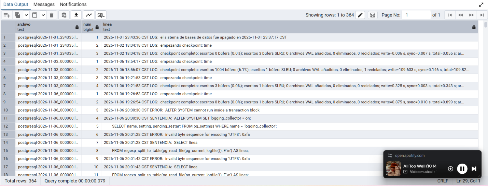

# LAB-01 — Bitácoras y auditoría del dato en PostgreSQL
_Gestión de seguridad y desempeño de bases de datos_

**Camacho Castañeda Angélica María 4-1** 
| # | Fecha y hora | Usuario | Cliente | Tipo de evento | Qué ocurrió | ¿Exitoso? | Fuente (línea o id_evento) |
| --- | --- | --- | --- | --- | --- | --- | --- |
| **1** | 2026-11-06 22:03:34.555 CST | postgres | ::1 (pgAdmin) | Privilegio | REVOKE UPDATE ON clientes FROM soporte_ana: se le quitó a soporte_ana el permiso de modificar clientes. | Sí | Bitácora, PID 16008 |
| **2** | 2026-11-06 22:03:37.632 CST | postgres | ::1 (pgAdmin) | Privilegio | GRANT UPDATE ON clientes TO app_ventas: se le dio a app_ventas el permiso de modificar clientes. | Sí | Bitácora, PID 16008 |
| **3** | 2026-11-06 22:03:39.921 CST | postgres | ::1 (pgAdmin) | Estructura | ALTER TABLE clientes ADD COLUMN segmento VARCHAR(20)`: se agregó una columna a la tabla. | Sí | Bitácora, PID 16008 |
| **4** | 2026-11-06 22:04:10.537 CST | postgres | ::1 (pgAdmin) | Identidad y secreto | CREATE ROLE rol_temporal LOGIN PASSWORD ...: se creó un rol y su contraseña quedó en la bitácora en texto plano. | Sí | Bitácora, PID 16008 |
| **5** | 2026-11-06 22:04:27.504 CST | postgres | ::1 (pgAdmin) | Identidad | DROP ROLE rol_temporal: se eliminó el rol temporal. | Sí | Bitácora, PID 16008 |
| **6** | 2026-11-06 22:26:22.244 CST | postgres | ::1 (pgAdmin) | Identidad | DROP ROLE soporte_ana: PostgreSQL lo rechazó porque el rol aún tenía privilegios sobre clientes. | No | Bitácora, PID 20896 (ERROR, DETAIL y STATEMENT) |
| **7** | 2026-11-06 22:59:11 CST | app_ventas | 127.0.0.1 (app-ventas-web) | Modificación de dato | UPDATE del RFC del cliente 3, de GAMA780912XYZ a GAMA780912ZZZ. | Sí | Auditoría, id_evento 1 |
| **8** | 2026-11-06 23:20:28.593 CST | postgres | ::1 (pgAdmin 4) | Manipulación de la auditoría | Desactivó el disparador (23:20:25), cambió el RFC del cliente 3 a GAMA780912GHI (23:20:28) y lo reactivó (23:20:31); el cambio no quedó en auditoria.cambios_clientes. | Sí | Bitácora, PID 14888 (líneas 298, 300 y 302); la auditoría sigue en 3 eventos |

**¿Quién cambió el RFC la primera vez (Actividad 3)? ¿Y en las Actividades 7, 12 y 14?**
En la Actividad 3 el cambio a GAMA780912XXX lo hice yo con el rol app_ventas desde la terminal, pero no puedo demostrarlo con evidencia del servidor, porque log_statement estaba en none y no existía el disparador. Mientras que, en la actividad 7 el cambio a GAMA780912XYZ lo hizo app_ventas desde 127.0.0.1 con la aplicación app-ventas-web, y la bitácora lo registró porque ya estaba en mod. En la actividad 12 el cambio a GAMA780912ZZZ también lo hizo app_ventas desde 127.0.0.1, y quedó en la tabla de auditoría como id_evento = 1, con usuario, aplicación e IP. En la actividad 14 lo hizo postgres desde psql con conexión local ([local]): desactivó el disparador, cambió el RFC a GAMA780912GHI y lo reactivó. Ese cambio solo aparece en la bitácora (PID 260), y la tabla de auditoría no lo registró.

**¿Quién cambió el teléfono?**
El cambio a 6679990000 lo hizo app_ventas desde 127.0.0.1 con la aplicación app-ventas-web, y solo queda como sentencia UPDATE en la bitácora. No quedó en la tabla de auditoría, porque el disparador todavía no existía cuando lo ejecuté.

**¿Hubo intentos de acceso fallidos? ¿De qué usuarios y desde dónde?**
Sí, todos fueron del usuario app_ventas, por contraseña incorrecta (error FATAL). Los dos primeros ocurrieron el 6 de noviembre a las 20:54:41 y a las 20:56:59 CST. Como en ese momento el prefijo de la bitácora solo tenía la hora, esas líneas no dicen desde qué IP vinieron. Con el prefijo nuevo, el intento de las 21:53:59 sí muestra client=127.0.0.1, aunque con app=[desconocido], porque la conexión falló antes de que se aplicara el nombre de la aplicación. Los intentos de app_ventas de borrar la auditoría y de desactivar el disparador no cuentan como accesos fallidos, porque ya había entrado y le faltaba permiso (error de autorización).

¿Qué valor tenía el RFC antes de cada cambio?
En la Actividad 3 no puedo saberlo, porque no quedó ningún registro del valor anterior. En la Actividad 7 la bitácora solo guarda el valor nuevo, y que antes era GAMA780912XXX lo sé por mi propio historial de comandos, no porque el servidor lo pruebe. En la Actividad 12 era GAMA780912XYZ, según valores_antes de la auditoría. En la Actividad 14 era GAMA780912ZZZ, pero como el cambio no quedó en la auditoría, lo deduzco de la cadena de cambios y no de un registro.
