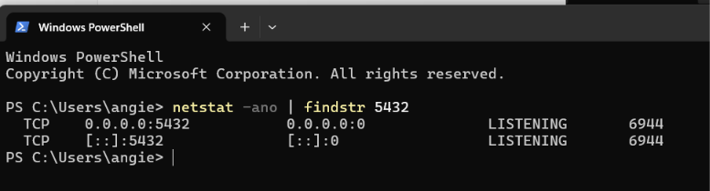

# LABORATORIO 4: HARDENING
#### DBA
#### Camacho Castañeda Angélica María 4-1

| Elemento | Estado actual | ¿Es necesario? | Riesgo |
| :--- | :--- | :--- | :--- |
| **Puerto PostgreSQL** | 5432 | Sí, pero se recomienda cambiarlo. | Medio: Usar el puerto predeterminado facilita escaneos automatizados y ataques de fuerza bruta. |
| **Interfaces de escucha** | Escuchando en todas (listen_addresses = '*') | No, solo debe escuchar en localhost o IP/redes específicas. | Alto: Expone la base de datos a accesos no autorizados directamente desde la red o Internet. |
| **Conexiones remotas** | Permitidas en pg_hba.conf | Depende: Solo si la aplicación/clientes residen en otros servidores. | Alto: Si no están restringidas por IP y reglas estrictas, incrementa la superficie de ataque. |
| **Usuarios administrativos** | Usuario postgres con superusuario y acceso estándar | Sí, pero restringido. | Alto: El uso rutinario de superusuarios para operaciones habituales puede derivar en pérdida o fuga total de datos. |
| **SSL/TLS** | Desactivado (ssl = off) | Sí, altamente recomendado para tráfico en red. | Alto: El tráfico se transmite en texto plano, permitiendo la intercepción de credenciales y datos. |
| **Métodos de autenticación** | Métodos débiles (md5 o trust) | No, se deben usar métodos seguros. | Crítico: trust permite acceso sin contraseña y md5 es vulnerable a ataques de captura/retransmisión. Usar scram-sha-256. |

**¿Por qué conocer la superficie de ataque debe preceder al hardening?**
Para priorizar los esfuerzos de seguridad. Al conocer exactamente qué elementos están expuestos, el hardening se puede enfocar en cerrar las vulnerabilidades reales y mitigar los riesgos más altos de forma eficiente.

# Actividad 2 — Identificar los archivos de configuración
**¿Por qué es importante conocer la ubicación física de estos archivos?**

Conocer la ubicación física de los archivos de PostgreSQL es importante porque cada uno cumple una función distinta y crítica: el directorio de datos (data_directory) almacena la información real de la base, postgresql.conf define cómo se comporta el servidor, pg_hba.conf y pg_ident.conf controlan quién puede autenticarse y desde dónde, y los logs (log_directory, junto con log_connections y log_disconnections) registran lo que ocurre en el sistema. Saber dónde está cada uno permite administrar y modificar la configuración correcta sin equivocarse de archivo, proteger con los permisos adecuados los elementos sensibles como las reglas de acceso y los datos, planificar respaldos completos

# 9. Actividad 3 — Revisar listen_addresses
**Configuración encontrada:**
* listen_addresses = '*'

**Interfaces necesarias:**
- Loopback (127.0.0.1 / ::1), para conexiones locales y administración.
- La interfaz de la red privada (por ejemplo 10.0.0.x o 192.168.x.x),
  solo si hay clientes o servidores de aplicaciones remotos que deban conectarse.

**Interfaces innecesarias:**
- La interfaz pública o con salida a Internet.
- Cualquier otra interfaz (redes de virtualización, Docker, etc.) que no usen
  los clientes autorizados.

## Análisis:

Con listen_addresses = '*' el servicio acepta conexiones por cualquier interfaz, incluso por las que no necesita, lo que amplía la superficie de ataque. Si el servidor tiene una IP pública y el firewall falla o se configura mal, el puerto 5432 queda expuesto a Internet, donde puede sufrir escaneos, ataques de fuerza bruta o intentos de explotar vulnerabilidades.

# Actividad 4 — Revisar pg_hba.conf

Consultar las reglas configuradas:

| Elemento                  | Resultado                                                        |
|---------------------------|------------------------------------------------------------------|
| Reglas locales            | socket Unix, sin red |
| Reglas IPv4               | 127.0.0.1|
| Reglas IPv6               | (::1)      |
| Bases de datos afectadas  | all y replication |
| Usuarios afectados        | all (cualquier rol) |
| Redes permitidas          | Solo localhost (127.0.0.1 y ::1) y socket Unix|
| Método de autenticación   | scram-sha-256 en todas las reglas |

# Actividad 5 — Analizar una regla permisiva
**1. ¿Qué bases de datos permite?**
all: cualquier base de datos del servidor, incluidas postgres, template1 y todas las de las aplicaciones. No distingue entre una base de producción y una de pruebas. (La palabra all no incluye replication, que se debe declarar aparte.)

**2. ¿Qué usuarios permite?**
all: cualquier rol, incluido postgres (el superusuario). Un atacante no necesita conocer el usuario de la aplicación; puede probar contra el superusuario directamente.

**3. ¿Qué direcciones de origen permite?**
0.0.0.0/0: todas las direcciones IPv4 posibles, es decir, cualquier equipo de Internet. La máscara /0 significa que no se fija ningún bit de la dirección. Para IPv6 haría falta una regla aparte (::/0), así que esta regla cubre solo IPv4.

**4. ¿Qué método de autenticación utiliza?**
scram-sha-256, que es un buen método basado en contraseña ya que no envía la contraseña en claro y resiste ataques de captura y repetición. Pero es la única barrera. Además, el tipo host acepta conexiones con o sin cifrado SSL/TLS; para obligar a cifrar habría que usar hostssl.

**5. ¿Por qué puede representar una exposición innecesaria?**
Por que convierte la base de datos en un objetivo accesible desde cualquier lugar. Cualquiera puede intentar fuerza bruta, o explotar una vulnerabilidad del motor.
Permite probar contra todos los usuarios y bases, incluido el superusuario.
Elimina la defensa en profundidad: si el firewall falla y listen_addresses = '*', el servidor queda expuesto de inmediato.
Viola el principio de mínimo privilegio ya que una aplicación normalmente necesita una base, un usuario y una o dos IPs, no todo el mundo.
Sin hostssl, las credenciales y los datos podrían viajar sin cifrar por redes no confiables.

**6. ¿Qué información necesitarías para restringirla?**
* Qué bases necesita cada cliente (por ejemplo, solo app_db).
* Qué usuarios/roles se conectan realmente (por ejemplo, app_user, no postgres).
* Qué IPs o redes de origen son legítimas: IP del servidor de aplicaciones, rango de la red privada o de la VPN, en formato CIDR.
* Si se usa TLS y si el servidor tiene certificados configurados.
* Qué rutas de red existen (firewall, grupos de seguridad, VPN), para confirmar que el tráfico llega solo desde donde se espera.

**Regla actual:**
host    all    all    0.0.0.0/0    scram-sha-256

**Problema:**
Permite que cualquier equipo de Internet intente conectarse a cualquier
base de datos con cualquier usuario, incluido el superusuario postgres.
La única barrera es la contraseña, lo que expone el servidor a fuerza
bruta y relleno de credenciales. Además, el tipo host no obliga a usar
cifrado y se viola el principio de mínimo privilegio.

**Origen que realmente necesita acceso:**
Solo la propia máquina. Las conexiones observadas en pg_stat_activity
vienen de ::1 (localhost IPv6). No se detectó ningún cliente remoto.

**Base de datos:**
pruebas_DBA

**Usuario:**
postgres (es el único rol con login; en un entorno real se recomienda
crear un usuario propio sin privilegios de superusuario) 

**Regla propuesta:**
host    pruebas_DBA    postgres    ::1/128    scram-sha-256

# Actividad 6 — Aplicar mínimo privilegio a conexiones
**Regla propuesta:**

host    pruebas_DBA    20529211_angelica_camacho    127.0.0.1/32    scram-sha-256

host    pruebas_DBA    20529211_angelica_camacho    ::1/128         scram-sha-256

Una regla de acceso debe ser muy específica porque cada parámetro que se deja abierto (all, 0.0.0.0/0) amplía la superficie de ataque. Al fijar una base, un usuario sin privilegios, una única dirección de origen y un método de autenticación robusto, un atacante necesitaría comprometer simultáneamente las cuatro condiciones para entrar, lo que aplica el principio de mínimo privilegio y la defensa en profundidad. Como se trabajó de manera local este laboratorio, el superusuario es postgres, por eso se decidió suponer un nuevo usuario (el cual es mi usuario en el pgadmin online).

# 13. Actividad 7 — Revisar autenticación
**¿Qué diferencia existe entre autenticación y autorización?**
 La autenticación es verificar quién es la persona que está intentando acceder, se verifica con un usuario y una contraseña. Mientras que autorización que se puede hacer una vez autenticado. En postgre se controla con roles y privilegios (GRANT, REVOKE, SELECT, INSERT, CREATE).
**¿Qué protege scram-sha-256?**
Protege las contraseñas de los usuarios y las sesiones de autenticación frente al robo, la interceptación y los ataques informáticos en bases de datos y sistemas.
**¿Por qué una contraseña almacenada mediante un mecanismo de autenticación no debe confundirse con cifrado reversible?**
Porque es un hash de un solo sentido ya que sirve para comprobar la contraseña, no para recuperarla. Si roban la base de datos, no obtienen las contraseñas originales, solo verificadores difíciles de atacar.

**¿Qué sucede si una cuenta tiene permisos excesivos aunque utilice una contraseña fuerte?**
La contraseña fuerte solo protege la entrada a la base de datos. Si la cuenta se compromete, el atacante tiene todos sus permisos, y con un superusuario podría leer, borrar o controlar todo el servidor. Por eso se aplica el mínimo privilegio para todos los usuarios.

# Actividad 8 — Revisar usuarios y privilegios
| Rol  | LOGIN | SUPERUSER | CREATEROLE | CREATEDB | Función                                                        |
|-------|-------|-----------|------------|----------|-----------|
| postgres           | Sí    | Sí        | Sí         | Sí       | Administración total del servidor                              |
| analista           | No    | No        | No         | No       | Rol de grupo para consulta; no puede iniciar sesión por sí solo |
| pg_roles (16 roles)    | No    | No        | No         | No       | Roles predefinidos de PostgreSQL con permisos específicos (lectura, monitoreo, mantenimiento) |

**¿Por qué no debería utilizarse una cuenta SUPERUSER como cuenta normal de una aplicación?**
Porque un SUPERUSER se salta todas las verificaciones de permisos, así que la aplicación tendría control total del servidor sin necesitarlo. Si la cuenta se compromete, el atacante podría leer, modificar o borrar todas las bases, crear roles, etc. Una cuenta con privilegios mínimos limita el daño a una sola base y aplica el principio de mínimo privilegio. El SUPERUSER debe reservarse para tareas muy puntuales y específicas.

# Actividad 9 — Separar cuentas administrativas y de aplicación
| Cuenta   | Nombre para cuentas | Propósito     | LOGIN |Privilegios                                              |
|----------|-----------|---------------------|-------|--------------------|
| DBA      | postgres        | Administración del servidor y las bases    | Sí    | Administrativos (SUPERUSER, CREATEROLE, CREATEDB)        |
| APP      | usuario (20529211_angelica_camacho)        | Conexión del software a pruebas_DBA        | Sí    | Mínimos (CONNECT, y SELECT/INSERT/UPDATE solo si lo necesita) |
| CONSULTA | analista_angelica_camacho   | Reportes y análisis    | Sí    | Solo lectura (SELECT)       |

¿Qué riesgo existe si la aplicación se conecta con una cuenta administrativa?

Si la aplicación se ve comprometida, el atacante tendrá privilegios administrativos. Podría leer, modificar o borrar todas las bases, crear roles, cambiar la configuración. Una cuenta con privilegios mínimos limita el daño a lo que la aplicación realmente necesita.

# Actividad 10 — Revisar extensiones
* qué extensiones existen: solo plpsql v1.0
* cuáles son necesarias:plpqsl para el lenguaje de postgresql
* cuáles fueron instaladas para prácticas: ninguna, plpsql ya viene por defecto
* cuáles podrían representar funcionalidad innecesaria en otro entorno: ninguna para este entorno y en ningun otro por que plpsql es necesario para el funcionamiento de postgre.

# Actividad 11 — Revisar configuración relacionada con conexiones
**¿Por qué mantener conexiones indefinidamente abiertas puede ser un problema?**

Cada conexión en PostgreSQL es un proceso del sistema operativo que consume memoria (y más si ejecuta consultas), aunque esté inactiva. Como max_connections es limitado, las conexiones abandonadas ocupan cupos y, al llenarse, los usuarios legítimos reciben el error too many clients already, lo que genera una denegación de servicio. Además, una transacción abierta e inactiva puede mantener bloqueos que frenan a otras sesiones e impide que VACUUM limpie filas muertas, lo que hincha las tablas y degrada el rendimiento. Por eso se recomienda configurar timeouts, cerrar sesiones inactivas y usar un pool de conexiones.

# Actividad 12 — Revisar permisos del sistema operativo
**¿Por qué no es suficiente proteger PostgreSQL mediante GRANT y REVOKE si cualquier usuario del sistema operativo puede leer archivos sensibles?**
GRANT y REVOKE solo controlan el acceso a través del motor de PostgreSQL. Si un usuario del sistema operativo puede leer los archivos directamente (datos, backups, logs, pg_hba.conf), se salta esos permisos por completo. 

# Actividad 13 — Revisar exposición de red

(Como se esta trabajando en windows, tuve que utilizar otro comando)

**Dirección de escucha:**
0.0.0.0 (todas las interfaces IPv4) y [::] (todas las interfaces IPv6)

**Puerto:**
5432 (TCP), estado LISTENING, PID 6944

**¿Está expuesto fuera de la interfaz necesaria?**
Sí, ya que solo se necesita localhost (127.0.0.1 y ::1), pero el servicio acepta
conexiones por cualquier interfaz, incluidas las de red local o pública.

# Actividad 14 — Diseñar una política de firewall
| Origen                | Destino                  | Puerto | Acción   |
|---------|-------|------|------|
| 10.10.10.0/24         | PostgreSQL (10.10.10.20) | 5432   | Permitir |
| Cualquier otro origen | PostgreSQL (10.10.10.20) | 5432   | Denegar  |

**¿Por qué pg_hba.conf y el firewall no son controles equivalentes?**

No son iguales por que operan en capas distintas. El firewall filtra el tráfico de red (IP origen, destino y puerto) antes de que llegue a PostgreSQL, y no sabe nada de cosas de auntenticación. pg_hba.conf actúa dentro del motor, por que la conexión ya llegó, y decide por base de datos, usuario, origen y método de autenticación si la pide. Además, el firewall bloquea el tráfico antes de que llegue a PostgreSQL, mientras que pg_hba.conf solo actúa cuando la conexión ya llegó al servicio. 

# Actividad 15 — Revisar TLS
***¿La conexión actual utiliza TLS?**
No. ssl = false en pg_stat_ssl, y el parámetro del servidor SHOW ssl está en off.
**Versión:**
[null] (no hay TLS, por lo tanto no hay versión negociada)
**Cipher:** [null] (no hay cifrado de transporte)

# Actividad 16 — Comparar configuración antes y después
| Control   | Antes    | Después  | Justificación  |
|-----------|----------------------|---------------|----------|
| listen_addresses         | *  (todas las interfaces) | localhost| Solo se necesita acceso local y reduce la superficie de exposición             |
| pg_hba.conf              | Reglas locales con all all | host pruebas_DBA 127.0.0.1/32 y ::1/128`  | Regla específica: base + usuario + origen + método|
| Método de autenticación  | scram-sha-256| scram-sha-256 (sin cambio)| Ya es el método más robusto basado en contraseña|
| Usuarios administrativos | postgres (único con login y SUPERUSER)| postgres, reservado solo para tareas especificas| El superusuario no se usa en aplicaciones|
| Cuentas de aplicación    | No existían (se usaba postgres)| Ningun cambio| Mínimo privilegio, si se creara un nuevo rol, pero no se hizo otro|
| Puerto| 5432, escuchando en 0.0.0.0 y [::]| 5432, escuchando solo en 127.0.0.1 y `[::1]| El puerto no cambia, pero ya no es alcanzable desde la red|
| TLS|ssl = off, conexión sin cifrar| Laboratorio local: sin cambio. Entorno real: ssl = on y hostss`| El tráfico local no sale del equipo; con clientes remotos TLS es obligatorio  |
| Permisos SO| Verificados con icacls en C:\Program Files\PostgreSQL\18\data port trabajar en windows, sin everyone ni Users| Sin cambios | GRANT/REVOKE no protegen los archivos fuera de postgre, los permisos del SO sí |
| Extensiones| Solo plpgsql 1.0| Solo plpgsql 1.0`| No hay funcionalidad innecesaria instalada|
| Conexiones| max_connections = 100, statement_timeout = 0, idle_in_transaction_session_timeout = 0`| No hubo cambios pero una propuesta es utilizar 30s para el timeout y 60 para transacciones  | Los timeouts evitan consultas colgadas y sesiones inactivas que consumen recursos |

# Actividad 17 — Elaborar checklist de hardening
| #  | Control                                | Verificado | Evidencia                                                                                   |
|----|----------------------------------------|------------|---------------------------------------------------------------------------------------------|
| 1  | Puerto documentado| Sí| Puerto 5432 (TCP), que se confirmó usando netstat -ano \| findstr 5432 (en windows) (PID 6944)|
| 2  | Interfaces de escucha justificadas| Sí  | listen_addresses = '*' en el estado inicial, se propone localhost porque solo hay uso local por que se trabaja de en una sola computadora|
| 3  | pg_hba.conf revisado| Sí| Consulta a pg_hba_file_rules donde hay 6 reglas, todas locales con scram-sha-256|
| 4  | Redes autorizadas restringidas| Sí| Solo 127.0.0.1/32 y ::1/128; regla 0.0.0.0/0 analizada y eliminada|
| 5  | Autenticación segura| Sí|scram-sha-256 en todas las reglas, sin trust ni md5|
| 6  | Superusuarios identificados| Sí|pg_roles solo postgres tiene rolsuper = true|
| 7  | Cuentas de aplicación separadas| Sí    | (APP) u_20529211_angelica_camacho y analista (CONSULTA)|
| 8  | Privilegios mínimos| Sí| analista con NOSUPERUSER, NOCREATEDB, NOCREATEROLE y solo CONNECT y SELECT a pruebas_DBA|
| 9  | Extensiones revisadas| Sí|pg_extension: solo plpgsql 1.0|
| 10 | TLS verificado| Sí| ssl = off, pg_stat_ssl.ssl = false, ssl_min_protocol_version = TLSv1.2; aceptable en local |
| 11 | Configuración protegida| Sí| Rutas mostradas con SHOW config_file, hba_file e ident_file|
| 12 | Directorio de datos protegido| Sí| icacls en C:\Program Files\PostgreSQL\18\data, sin Everyone ni Users|
| 13 | Firewall documentado| Sí| La regla conceptual es permitir 10.10.10.0/24 a 10.10.10.20:5432, denegar el resto|
| 14 | Actualizaciones documentadas| Sí  | POSTGRESQL v.18.6  |
| 15 | Configuración registrada| Sí| Algunos cambios documentados en la actividad anterior|
| 16 | Límites de conexión y timeouts| Sí| max_connections = 100; statement_timeout = 0 e idle_in_transaction_session_timeout = 0 (propuesta: 30s y 60s) |
| 17 | Logs de conexión habilitados | No | log_connections vacío (desactivado en PG 18) y log_disconnections = off, propuesta: activar ambos para auditar quién entra y sale |                        |
| 18 | Respaldos de datos y configuración | No | No se realizó, por que es laboratorio local sin información crítica|

# Actividad 18 — Caso integral
| #  | Problema| Riesgo| Control propuesto|
|----|--------|----------------|---------------|
| 1  | Acepta conexiones desde cualquier IPv4 (0.0.0.0/0)  | Cualquier equipo de Internet puede intentar conectarse| Restringir el origen a IPs o redes específicas (por ejemplo /32 o /24) |
| 2  | La aplicación usa un usuario con privilegios administrativos | Si se compromete la app, el atacante controla todo el servidor | Crear un rol de aplicación con mínimo privilegio|
| 3  | listen_addresses = '*' (todas las interfaces)| Servicio expuesto en interfaces que no lo necesitan| Limitar listen_addresses a la interfaz necesaria|
| 4  | Firewall permite 5432 desde cualquier origen| Sin barrera de red, el puerto es visible y atacable desde Internet| Permitir 5432 solo desde la red autorizada y denegar el resto|
| 5  | pg_hba.conf con all/all desde 0.0.0.0/0| Cualquier base y usuario (incluido postgres) se puede probar| Regla de base + usuario + origen + método|
| 6  | Superusuario accesible de forma remota| Fuerza bruta directa contra la cuenta con todos los permisos| Prohibir login remoto del superusuario y que solo pueda usarlo solo desde local|
| 7  | Sin cifrado TLS obligatorio (host en lugar de hostssl) | Credenciales y datos pueden ser interceptados en tránsito| Activar ssl = on, usar hostssl y TLS 1.2 o superior|
| 8  | Base de datos expuesta directamente, sin capa intermedia | Un fallo del motor o una vulnerabilidad queda al alcance de internet | Colocar la bd en red privada, accesible solo desde el servidor de aplicaciones |
| 9  | Sin límites de conexión ni timeouts| Agotamiento de conexiones (denegación de servicio) por ataques o abuso | Configurar max_connections, statement_timeout e idle_in_transaction_session_timeout|
| 10 | Sin evidencia de logs de conexión ni monitoreo| Los intentos de intrusión no se detectan ni se pueden investigar       | Activar log_connections y log_disconnections y revisar los logs        |
| 11 | Un solo control (la contraseña) protege todo| Si la contraseña se filtra, no hay una segunda barrera| Defensa en profundidad: red, firewall, pg_hba.conf, roles y TLS|

**¿Es suficiente tener contraseñas fuertes?**
No, una contraseña fuerte solo protege la parte de autenticación y aun así puede filtrarse, además, no reduce la exposición de red, no limita lo que la cuenta puede hacer una vez dentro, no cifra el tráfico ni permite detectar intrusiones. En este escenario, si la aplicación se compromete, el atacante hereda privilegios administrativos sin necesidad de adivinar la contraseña. La seguridad requiere varios factores como red privada, firewall, pg_hba.conf específico, TLS, mínimo privilegio, logs y monitoreo.

# Actividad 19 — Construcción de una línea base
# Baseline de seguridad para PostgreSQL 16

### Red
| Control | Valor de la línea base |
|---|---|
| Interfaces autorizadas | listen_addresses = 'localhost', o una IP privada del servidor si hay clientes remoto, nunca se debe dejar '*' |
| Puerto | 5432/TCP verificado con ss -lnt o netstat -ano|
| Firewall | Política por defecto, denegar. Permitir 5432 solo desde las redes autorizadas |
| Redes permitidas | Solo la red de aplicación/DBA (por ejemplo `10.10.10.0/24`); sin acceso desde Internet |

### Autenticación
| Control | Valor de la línea base |
|---|---|
| Método | scram-sha-256, se deben prohibir trust, password y md5 |
| password_encryption| scram-sha-256 |
| Políticas de credenciales | Contraseñas largas y únicas por cuenta, rotación periódica, fechas especificas de duración en roles, secretos fuera del código fuente |
| Cuentas administrativas | postgres solo para administración y desde local |
| pg_hba.conf | Reglas específicas: base + usuario + origen + método. Las reglas específicas van antes de las generales y no hay 0.0.0.0/0 |

### Autorización
| Control | Valor de la línea base |
|---|---|
| Roles | Tres tipos: DBA (administración), APP (aplicación) y CONSULTA (solo lectura). Los permisos se asignan a roles de grupo |
| Privilegios | Mínimo privilegio, CONNECT solo a quien lo necesita, GRANT solo sobre los objetos requeridos |
| Cuentas de aplicación | sin permisos de super usuario y solo lo necesario, una cuenta por aplicación y sin compartirla con la administración |

### Configuración
| Control | Valor de la línea base |
|---|---|
| Parámetros relevantes | ssl = on, ssl_min_protocol_version = 'TLSv1.2', log_connections = on, log_disconnections = on, log_line_prefix con usuario, base, IP y hora |
| Conexiones |max_connections ajustado a la carga real, superuser_reserved_connections = 3, statement_timeout y idle_in_transaction_session_timeout distintos de 0 (por ejemplo 30s y 60s) |
| Extensiones | Solo las necesarias (plpgsql), revisar pg_extension periódicamente |
| Logs | Rotación y retención definidas; acceso restringido |

### Sistema operativo
| Control | Valor de la línea base |
|---|---|
| Propietario de archivos | Usuario del servicio  |
| Permisos | Linux: directorio de datos con 700, postgresql.conf y pg_hba.conf con 600 mientras que para windows sin everyone ni users |
| Directorio de datos | Fuera de rutas compartidas, en un disco o volumen dedicado con espacio vigilado; respaldos y logs con las mismas restricciones |
| Servicio | PostgreSQL corre con una cuenta sin privilegios, nunca como root ni admin |

## 6. Cifrado
| Control | Valor de la línea base |
|---|---|
| TLS | ssl = on con certificados válidos, reglas hostssl para clientes remotos; verificado con `pg_stat_ssl|
| Protección de credenciales | Verificadores SCRAM en el servidor; no guardar contraseñas en texto claro en scripts, repositorios |
| Información sensible | Cifrado de disco o volumen, respaldos cifrados, pgcrypto` o cifrado a nivel de aplicación para campos críticos y datos sensibles fuera de los logs |

## 7. Mantenimiento
| Control | Valor de la línea base |
|---|---|
| Actualización | Aplicar las versiones menores de PostgreSQL 16 (parches de seguridad) con ventana de mantenimiento; registrar la versión con SELECT version();|
| Revisión periódica | Cada tres meses a pg_hba_file_rules, roles y privilegios, extensiones, exposición de red y logs |
| Respaldos | pg_dump o pg_basebackup más copia de los archivos de configuración, guardados fuera del servidor, con pruebas de restauración |
| Documentación | Línea base versionada, registro de cambios (antes/después) y checklist con evidencia |